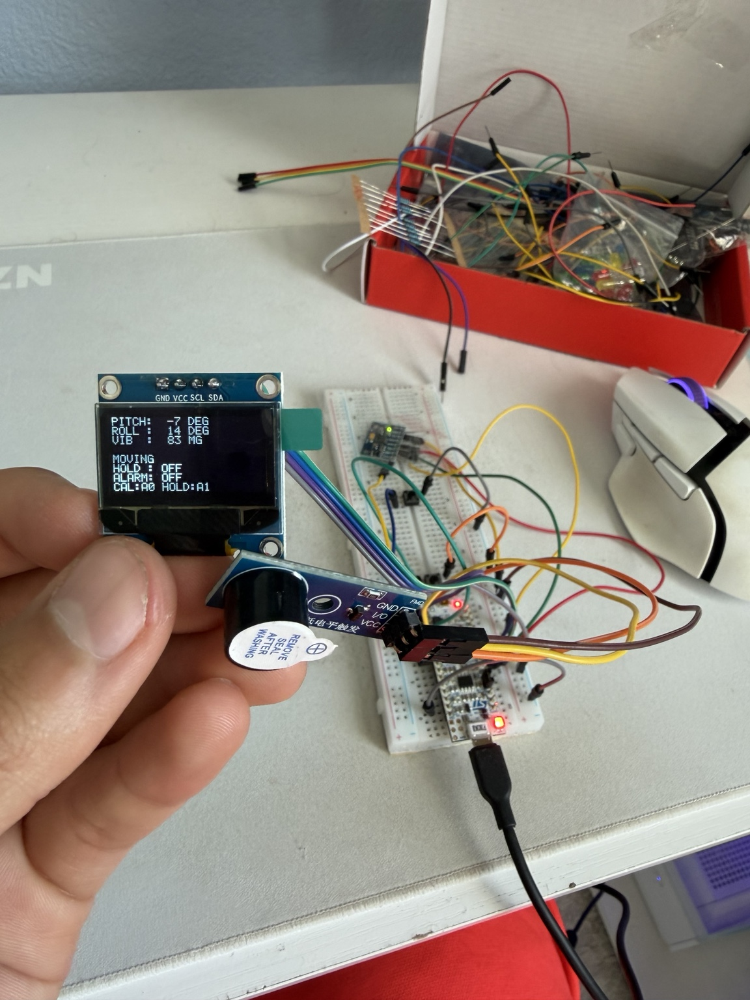
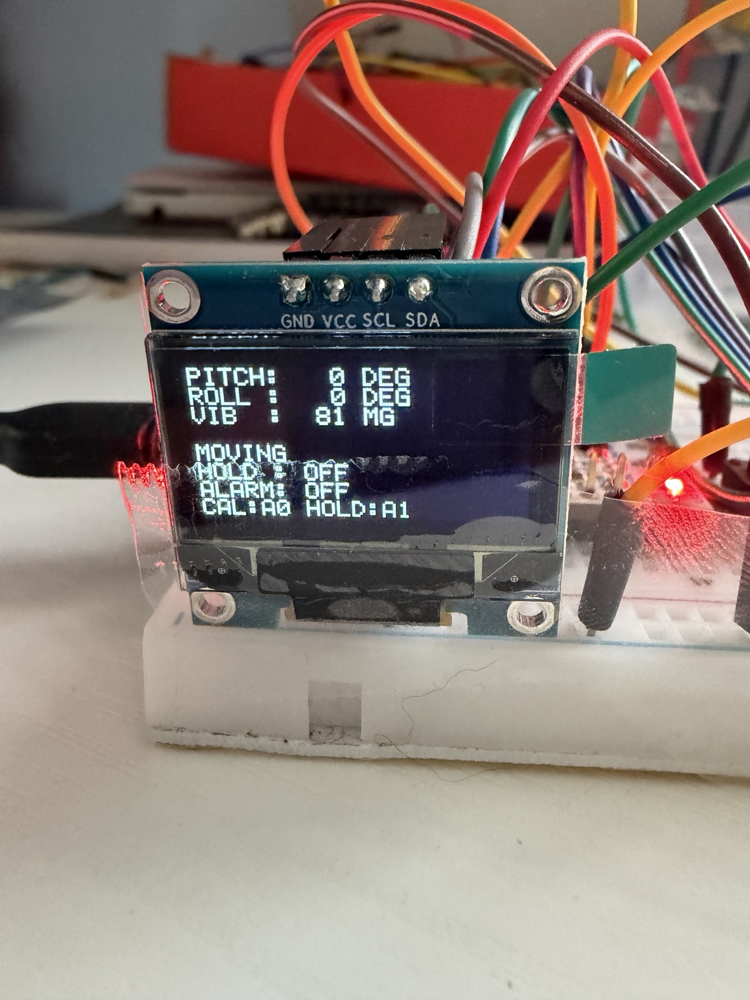
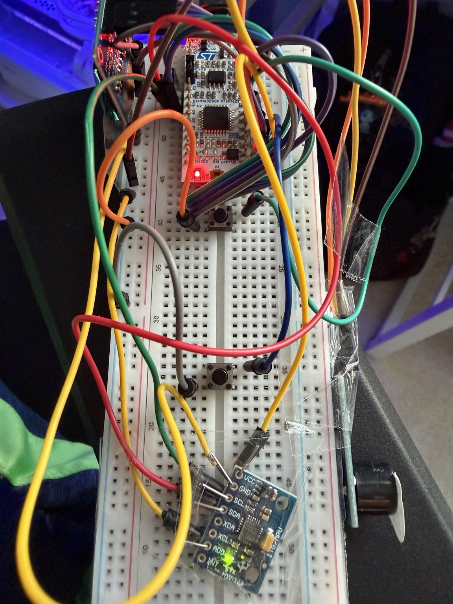
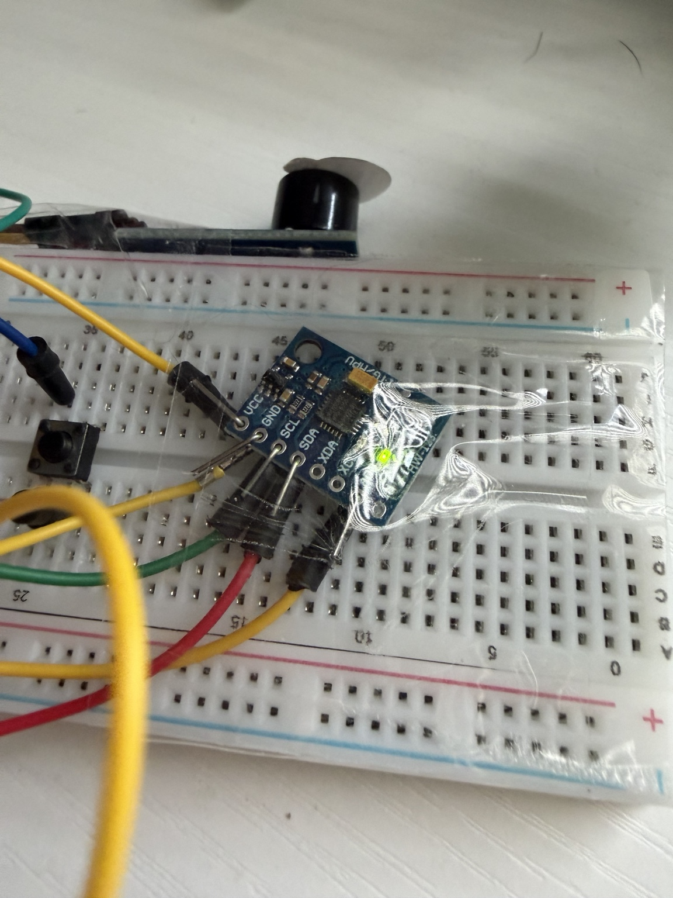
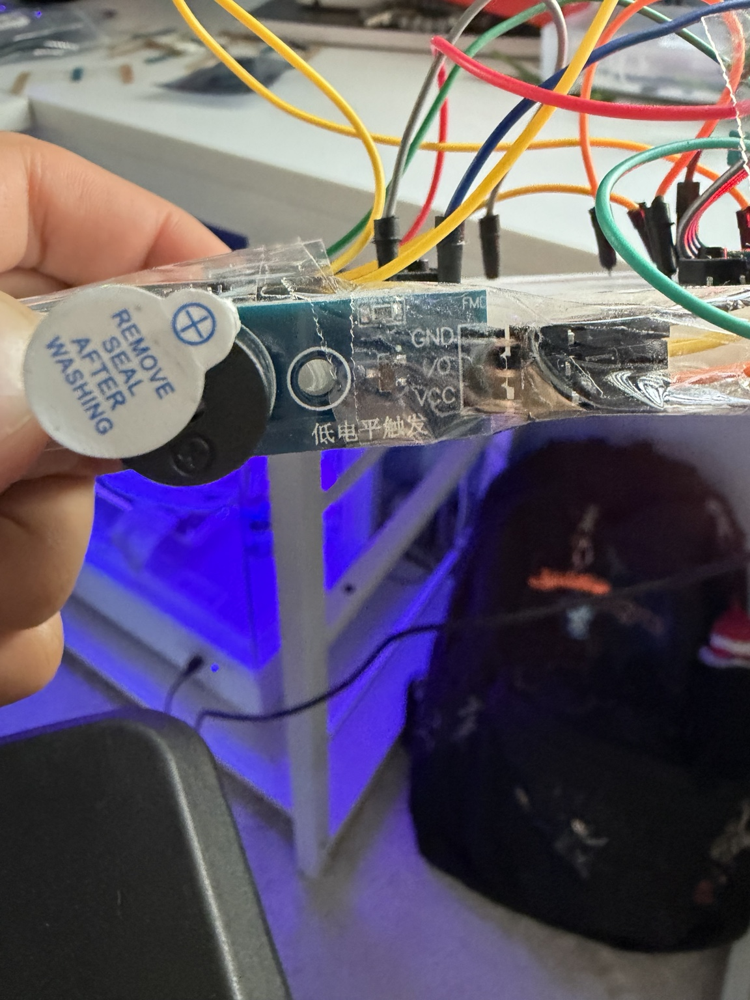

# Smart Leveling Device
 
An STM32-based leveling device that measures tilt and vibration using an MPU6050 accelerometer. The system displays live measurements on an OLED screen and uses a buzzer to warn when the device is tilted too far or experiences excessive vibration.

 

*Completed STM32 leveling device showing the OLED display, buzzer, and hardware setup.*
  

## Overview

For this project, I built a leveling and vibration monitoring system using the STM32 NUCLEO-F303K8 microcontroller. The goal was to create a device that could measure its orientation, display the readings, and alert the user when it was no longer level.

I used an MPU6050 accelerometer to measure movement and calculate pitch and roll angles. The readings are displayed on an OLED along with vibration measurements and the current stability status.

I also added two push buttons. One lets the user calibrate the device to its current position, and the other holds the displayed angle readings so they can be referenced later. A buzzer activates when the tilt or vibration exceeds the limits set in the code.

## Why I Chose These Components

### STM32 NUCLEO-F303K8

I went with the STM32 NUCLEO-F303K8 because I wanted more experience working directly with microcontrollers instead of using something like an Arduino. Since I'm studying Computer Engineering, I wanted to get more familiar with embedded C, configuring peripherals, and understanding how the hardware and software work together.

The STM32 was a good choice for this project because it already has the interfaces I needed, including I2C for the sensors and display, GPIO for the buttons and buzzer, and UART for debugging.

I also liked that I could configure everything through STM32CubeIDE and use the HAL libraries to communicate with the hardware. This let me focus more on the sensor readings, calibration, and warning system instead of having to write every low-level driver from scratch.

Another reason I chose it was that the project didn't need a full operating system or a powerful processor. The STM32 could handle reading the accelerometer, calculating angles, updating the OLED, and controlling the buzzer in one continuous loop. It made more sense to use a microcontroller for something like this rather than a Raspberry Pi.

### MPU6050 Accelerometer

I chose the MPU6050 because I needed a way to measure the orientation of the device and detect when it was moving.

The MPU6050 has a built-in three-axis accelerometer and gyroscope, so it provides more than enough sensor capability for a project like this. For my implementation, I mainly used the accelerometer readings to calculate pitch and roll.

One thing I liked about it was that I could get the acceleration values for all three axes through I2C without needing separate sensors for each direction. This kept the wiring simpler and made it easier to connect everything to the STM32.

I used the acceleration measurements to calculate the tilt angles and estimate vibration. Since accelerometer readings can fluctuate, I also added a smoothing filter in the code to make the displayed values more stable.

Using one sensor for both tilt and vibration monitoring helped keep the hardware simple while still giving me the measurements I needed.

### OLED Display

I chose an OLED display because I wanted the device to show its measurements without needing to stay connected to a computer.

The display communicates through I2C, which worked well because I was already using that interface for the MPU6050. Both devices can share the same I2C bus since they use different addresses.

I also preferred the OLED over using multiple LEDs because I could display actual angle measurements, vibration values, and system status instead of only showing whether something was wrong.

The screen is small, but it has enough room for all the information I wanted to show. It also made the project easier to test because I could immediately see how the readings changed when I moved the device.

### Buzzer and Push Buttons

For the warning system, I decided to use a buzzer because I wanted the device to alert the user without requiring them to constantly look at the OLED.

I programmed the buzzer to activate when the pitch or roll goes beyond 4 degrees from the calibrated position or when the vibration estimate reaches the set threshold.

I also added two push buttons instead of making the system completely automatic.

The first button is for calibration. I wanted the user to be able to set their own reference position instead of assuming that the sensor would always be mounted perfectly level.

The second button controls hold mode, which saves the current angle readings on the display. I thought this would be useful when comparing the device's position before and after moving it.

Both buttons use GPIO inputs with internal pull-up resistors, which helped keep the wiring simple without needing external pull-up resistors.

## Hardware Used

- STM32 NUCLEO-F303K8
- MPU6050 accelerometer
- I2C OLED display
- Active buzzer
- Two push buttons
- LED
- Breadboard and jumper wires

## Software Used

- STM32CubeIDE
- Embedded C
- STM32 HAL libraries
- I2C communication
- UART communication

## How It Works

### Angle Measurement

The STM32 communicates with the MPU6050 over I2C and reads acceleration data from the X, Y, and Z axes.

Using these values, the program calculates pitch and roll with the `atan2f()` and `sqrtf()` functions. I also added a smoothing filter to reduce fluctuations in the readings.

The filter uses 70% of the previous measurement and 30% of the new measurement.

### Calibration

The calibration button is connected to PA0.

When pressed, the program saves the current pitch and roll as offset values. These offsets are subtracted from future measurements, allowing the device to treat its current position as level.

The filtered readings are also reset to zero when calibration occurs.

### Hold Mode

The second button, connected to PA1, toggles hold mode.

When hold mode is enabled, the program saves the current pitch and roll readings and keeps those values on the OLED. The STM32 continues reading the sensor in the background, so the warning system still responds to movement.

Pressing the button again returns the display to live measurements.

### Vibration Detection

The program calculates the total acceleration magnitude from the three accelerometer axes.

It then estimates vibration by measuring how far the acceleration magnitude differs from 1 g.

Based on the filtered value, the OLED displays one of three states:

- **STABLE:** Below 0.08 g
- **MOVING:** 0.08 g to below 0.20 g
- **HIGH VIBRATION:** 0.20 g or higher

### Buzzer Warning

I connected an active-low buzzer to PA4 to provide an audible warning.

The buzzer activates when:

- Pitch exceeds ±4 degrees from the calibrated position.
- Roll exceeds ±4 degrees from the calibrated position.
- The raw vibration estimate reaches 0.20 g or higher.

Once the measurements return within those limits, the buzzer turns off.

### OLED Display

The OLED shows the following information:

- Pitch angle
- Roll angle
- Vibration measurement in mg
- Stability status
- Hold mode ON/OFF
- Alarm ON/OFF

I used I2C to communicate with both the MPU6050 and the OLED display.

### UART Output

I also configured USART2 at 38400 baud to send measurements to a serial terminal.

This helped with checking the sensor readings, calibration offsets, and hold mode while testing the system.

## Pin Connections

| STM32 Pin | Component / Function |
|---|---|
| PA0 | Calibration button |
| PA1 | Hold button |
| PA4 | Buzzer |
| PB3 | Calibration indicator LED |
| I2C1 | MPU6050 and OLED |
| USART2 | Serial output |

The full pin configuration is included in the `project.ioc` file.

## Project Files

- `Core/` - Main C code, header files, and peripheral initialization
- `Drivers/` - STM32 HAL and device support files
- `project.ioc` - STM32CubeMX pin and peripheral configuration
- `STM32F303K8TX_FLASH.ld` - Linker script

## Running the Project

1. Open the project in STM32CubeIDE.
2. Verify the board and peripheral configuration in `project.ioc`.
3. Connect the MPU6050, OLED, buttons, and buzzer.
4. Build the code and flash it to the STM32 NUCLEO-F303K8.
5. Use the calibration button to set the reference angle.
6. Tilt or move the device to observe the OLED measurements and buzzer response.
7. Use the hold button to freeze the displayed pitch and roll readings.

## Project Photos and Demo

### Project Demonstration

[Watch my project presentation and hardware demonstration on YouTube](https://www.youtube.com/watch?v=Wyx7LZYfKUg)

In this video, I go over the project design, explain the hardware and software, and demonstrate the device working.

### Final Project Report

[View my final technical report](Documentation/Final%20Project%20Report%20-%20Yousef%20Ahmadzai.pdf)

The report includes my system block diagram, hardware setup, angle calculations, testing results, and what I learned from building the device.

### Hardware Photos

| OLED Display | STM32 and MPU6050 Wiring |
|:---:|:---:|
|  |  |

| MPU6050 Accelerometer | Active Buzzer |
|:---:|:---:|
|  |  |

Additional hardware photos are available in the [Images folder](Images/).

## Challenges and Troubleshooting

One thing I had to work on with this project was getting the accelerometer readings to be stable enough to use. Since the MPU6050 is sensitive to movement, the pitch and roll values could fluctuate even when I wasn't intentionally changing the angle. To help with this, I added a smoothing filter that uses 70% of the previous reading and 30% of the new reading. This made the measurements easier to read on the OLED without having them constantly jump around.

Another thing I noticed during testing was that the buzzer would respond to movement faster than the OLED would update its displayed status. The warning system uses the raw vibration value while the display uses a filtered value, so there can be a slight difference in when each responds. I kept the buzzer response separate so it could react to sudden movement without waiting for the displayed measurements to catch up.

I also originally planned on adding an LED indication system with green, yellow, and red LEDs depending on how close the device was to exceeding the angle limit. After getting the OLED and buzzer working, I decided it wasn't really necessary anymore since the screen already displayed the actual angle and the buzzer warned when the limit was exceeded.

One thing I would improve in the future is the physical setup. Right now the device uses a breadboard with a lot of jumper wires, so I would want to make the wiring cleaner and put everything into a proper enclosure. I would also like to make it battery powered instead of needing a USB connection, which would make it easier to use when checking whether a shelf or another surface is level.

## What I Learned

This project gave me more experience working with STM32 microcontrollers and connecting multiple components through I2C and GPIO. One of the main parts was getting the accelerometer readings into a useful format and making the displayed angles stable enough to read.

I also worked on handling button inputs, implementing calibration offsets, and getting the OLED and buzzer to respond correctly to the sensor measurements.

Overall, it was good practice combining sensor data processing, hardware interfacing, and embedded C into one working system.
